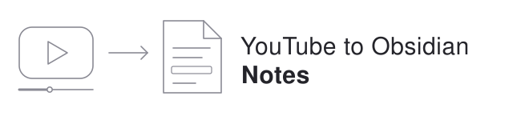

# YouTube to Obsidian Notes

<p align="center">
  <picture>
    <source media="(prefers-color-scheme: dark)" srcset="docs/wordmark-dark.svg">
    
  </picture>
</p>

YouTube to Obsidian Notes is a [Claude Code](https://claude.com/claude-code) skill. Give it a YouTube video, a playlist or a transcript, and it writes study notes into your Obsidian vault.

The notes are made to learn from and to revise, not to skim. They keep the speaker's full explanation, and after each paragraph they add one line that says the same idea in simple words. Each note ends with its key learnings and a few questions to test yourself. Screenshots of the video's diagrams sit next to the text they explain, each with a link back to that moment in the video.

```markdown
The model loads each layer's weights from memory once, and uses that single transfer for
every token in the prompt. For a 2,000-token prompt, each byte does about 2,000 operations.

==🔵 Meaning: The chip loads the weights one time and uses them for all prompt tokens.
Many tokens share the data cost.==
```

## A quick tour

<table>
  <tr>
    <td width="50%" valign="top">
      <b>Sub-note</b><br>
      <sub>One per topic of the video. Main learning on top, the original text with a Meaning line after each paragraph, screenshots with timestamps, key learnings and a self-test at the end.</sub>
    </td>
    <td width="50%" valign="top">
      <b>Chapter overview</b><br>
      <sub>One per video. The whole video in one paragraph, a table of its sub-notes, a diagram of the argument, the top ten learnings, the numbers to remember and the transcript fixes.</sub>
    </td>
  </tr>
  <tr>
    <td width="50%" valign="top">
      <b>Playlist index</b><br>
      <sub>One per playlist. The chapters and their status, a running list of learnings, the formulas, and searches that collect every key learning or question.</sub>
    </td>
    <td width="50%" valign="top">
      <b>Revision summary</b><br>
      <sub>One page for the whole playlist. A card per chapter, the top twenty learnings, cheat sheets for formulas and numbers, and one question per chapter.</sub>
    </td>
  </tr>
</table>

A full example sub-note is in [`examples/sample-sub-note.md`](examples/sample-sub-note.md). Open it in Obsidian to see the callouts.

## Features

### Notes

- **Original text, kept**: the transcript is cleaned up (filler, repeats and caption errors removed), but the speaker's reasoning, examples and numbers stay. A 30-minute video becomes several sub-notes, not one short summary.
- **Meaning lines**: after each paragraph, `==🔵 Meaning: …==` repeats the idea in short sentences. They follow [Simplified Technical English](https://www.asd-ste100.org): active voice, one idea per sentence, at most 25 words.
- **Learnings**: each sub-note starts with a **Main learning** callout and ends with a **Key learnings** box. A star marks the one to three points that matter most.
- **Self-test**: questions as collapsible callouts, so the answer stays hidden until you open it.
- **Links**: sub-notes link to the previous and next one, to the chapter overview, to earlier chapters and to notes that already exist in your vault. Every link uses a note's file name and is checked before the work is done.
- **Transcript fixes**: auto-captions get names, products and numbers wrong. The skill corrects them in the notes and lists every fix in the chapter overview.

### Screenshots

- **Diagrams only**: the skill takes a frame every 10 seconds, lays them out in grids, and keeps the frames that show a complete diagram, chart or table. It skips faded frames, frames caught mid-animation and title cards.
- **Timestamps**: under each screenshot, a `▶ m:ss` link opens the video at that second.
- **Files**: screenshots are PNGs named `<prefix>-<seconds>.png` (for example `llm-inf-ch3-0130.png`) in the vault's attachment folder. About 10 to 35 MB for a 30-minute video.

### Playlists

- **One folder per video**, numbered in playlist order, inside one folder for the playlist.
- **Several videos in one request**: "Do the same for videos 7, 8 and 9" downloads all of them first, then writes one chapter at a time.
- **Indexes stay current**: after each chapter, the playlist index and your subject index get a new row, new learnings and new formulas.

### Your vault stays yours

- **No commits**: the skill never commits or pushes your vault, so it works next to obsidian-git auto-backup.
- **No deletes**: a note that gets replaced is marked `status: outdated` and links to the new one.
- **No leftovers**: the downloaded video is deleted when the notes are done.
- **Asks first**: it asks before it installs anything.

## Install

You need [Claude Code](https://claude.com/claude-code), [yt-dlp](https://github.com/yt-dlp/yt-dlp) and [ffmpeg](https://ffmpeg.org).

```bash
git clone https://github.com/madhav-wakhare/youtube-to-obsidian-notes ~/.claude/skills/youtube-to-obsidian-notes
brew install yt-dlp ffmpeg
```

On Linux, install ffmpeg with your package manager and yt-dlp with `pipx install yt-dlp`.

To update:

```bash
git -C ~/.claude/skills/youtube-to-obsidian-notes pull
```

## Use

Ask Claude Code in plain words. The skill starts on its own:

| You say | What happens |
| --- | --- |
| "Add this playlist to my Obsidian vault under AI: `<url>`" | Creates the playlist folder and index, then writes chapter 1 |
| "Do the same for the next video" | Writes the next chapter and updates the indexes |
| "Do the same for videos 7, 8 and 9" | Downloads all three, then writes them one by one |
| "Here is the transcript: …" | Uses your transcript instead of downloading captions |
| "Add screenshots from the video to these notes" | Adds diagrams to notes that already exist |
| "Make a revision summary for the whole playlist" | Writes the one-page revision note |

You can also run `/youtube-to-obsidian-notes <url>`.

## Configuration

| Setting | Default | Meaning |
| --- | --- | --- |
| Vault path | asked on first use | Tell Claude the path, or set `OBSIDIAN_VAULT=/path/to/vault` |
| Attachment folder | from `.obsidian/app.json`, else `images/` | Where screenshots go |
| Screenshot prefix | `<playlist-slug>-ch<N>` | File name prefix for each chapter's screenshots |
| Meaning-line check | on if available | Uses a `simplified-technical-english` skill if one is installed; skipped if not |

To change the note layout, edit [`references/templates.md`](references/templates.md). To change the rules (naming, tags, image format), edit [`references/conventions.md`](references/conventions.md). Claude follows both files.

## What it writes

```
<vault>/
  images/
    llm-inf-ch1-0130.png                        screenshots, one file per diagram
  AI-inference/
    06 Engineering Behind LLM Inference/        one folder per playlist
      LLM Inference … - Playlist Index.md
      LLM Inference - Revision Summary.md
      01 The Memory Wall/                       one folder per video
        01 The Memory Wall.md                   chapter overview
        1.1 What LLM Inference Is.md            sub-notes
        1.2 The 30 ms Puzzle.md
```

## How it works

1. **List the videos** in the playlist with yt-dlp.
2. **Get the transcript**: your pasted text, or YouTube's captions through yt-dlp. When YouTube refuses caption downloads (`HTTP Error 429`), it reads the transcript panel on the video page in Claude Code's browser instead.
3. **Make contact sheets**: one frame every 10 seconds, in grids of 4 by 5. The time of each tile is known exactly, so a chosen tile maps to an exact second.
4. **Pick the diagrams** from the sheets and save them at full size.
5. **Plan the sub-notes** from the video's own chapter list.
6. **Write the notes**, with `{{img 130}}` placeholders where screenshots go.
7. **Insert the screenshots**: a script turns each placeholder into the image and its timestamp link, and reports frames that are unused or missing.
8. **Update the indexes**.
9. **Check**: every link resolves, every Meaning line passes the language check, every screenshot is used.
10. **Clean up**: delete the downloaded video.

## Files

```
SKILL.md                     the workflow Claude follows
references/
  templates.md               layouts for each note type
  conventions.md             vault rules, naming, frontmatter, transcript fixes, lessons learned
scripts/
  make_sheets.sh             download a video, build contact sheets
  extract_frames.sh          save chosen frames into the vault
  preview.sh                 tile candidate frames for a second look
  vtt_to_text.py             turn auto-captions into timestamped text
  expand_images.py           insert screenshots, report unused or missing frames
  check_links.py             find links that do not resolve
  check_meaning_ste.sh       check Meaning lines against Simplified Technical English
examples/
  sample-sub-note.md         one finished sub-note
docs/                        images used in this README
```

- The scripts need bash, Python 3 and ffmpeg. They take absolute paths and do not change anything outside the folders you pass to them.
- The skill was built and tested on a nine-part technical course of about four hours. The note structure works for any lecture, talk or course.

## License

[MIT](LICENSE)
